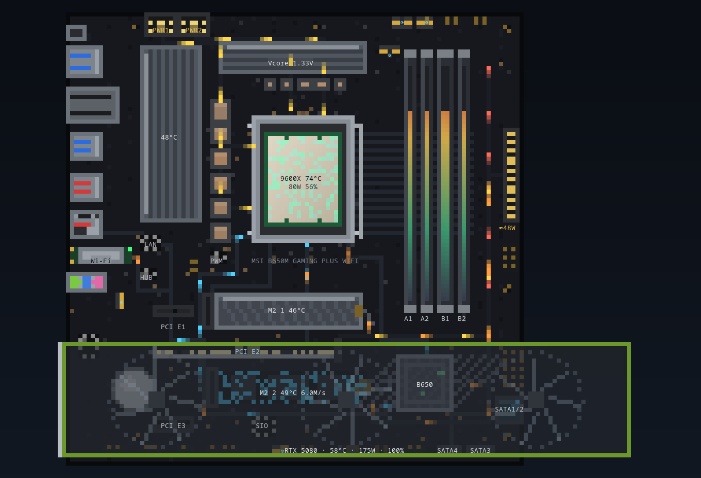
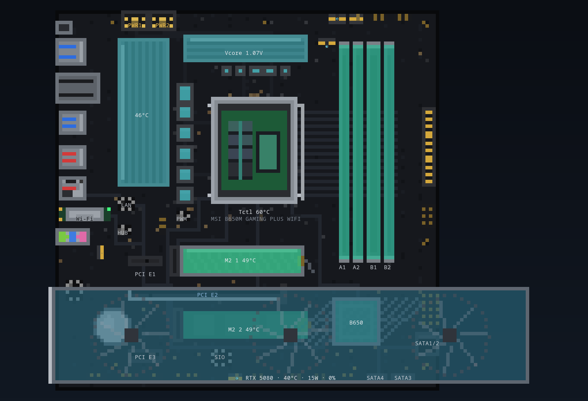
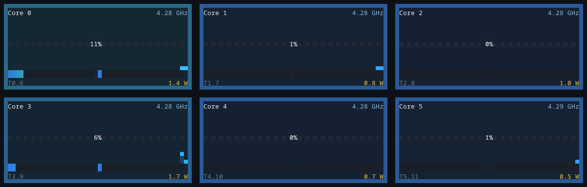
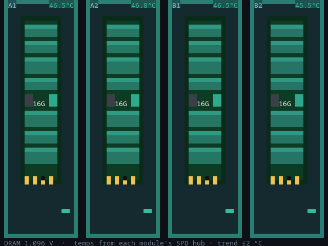
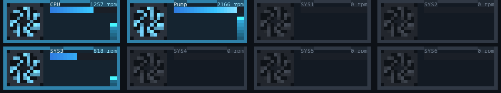
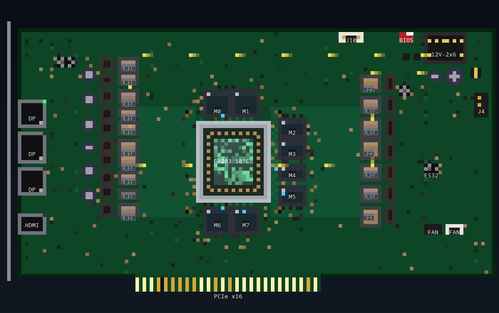
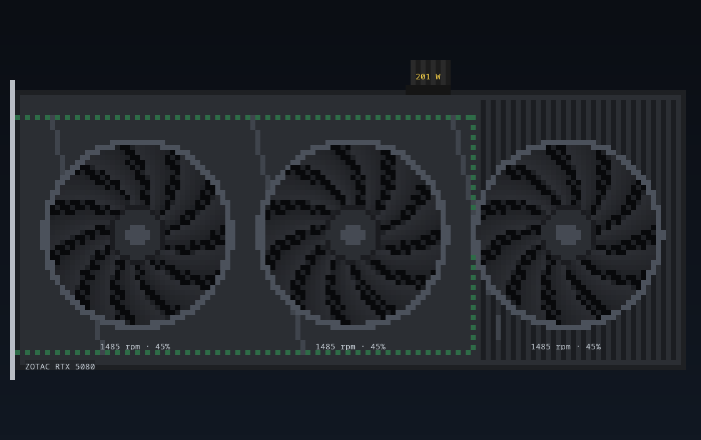
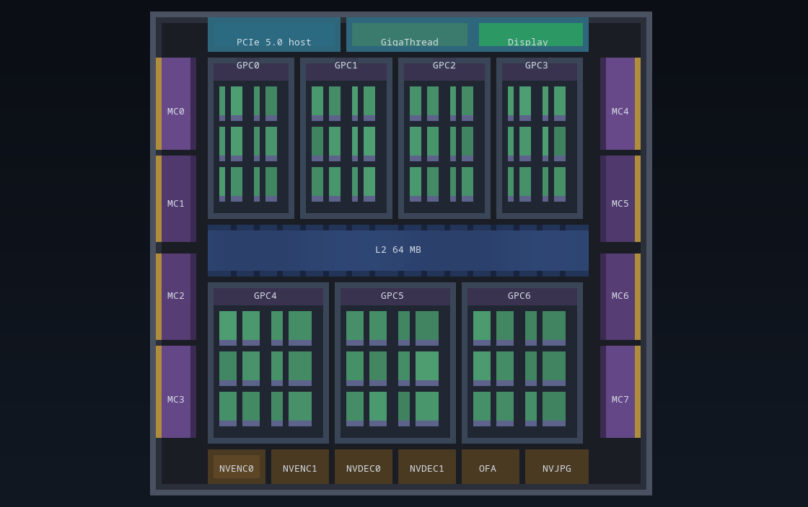
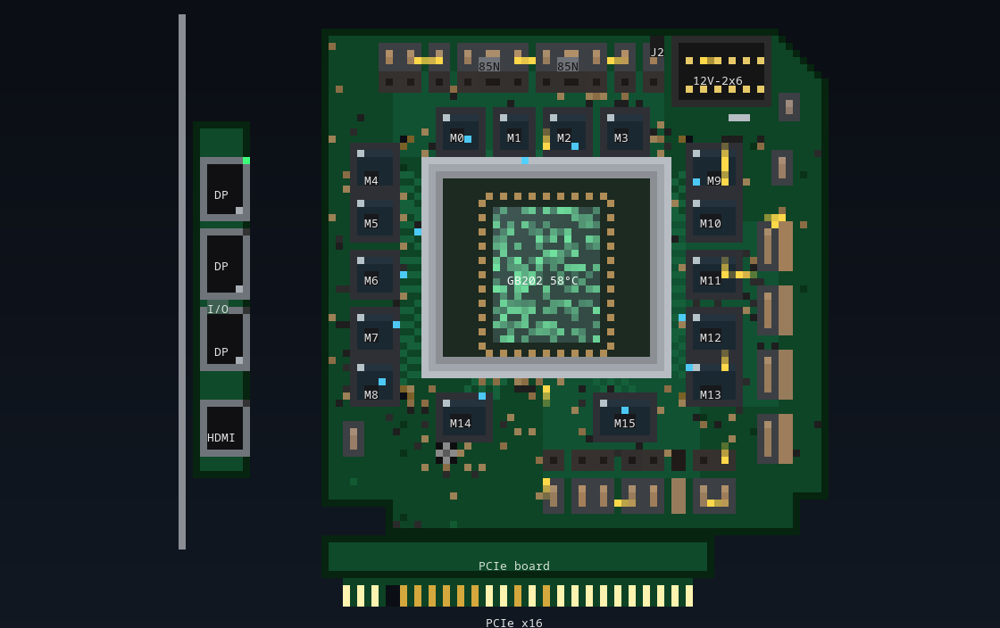

# systui

Two terminal apps in one tree: **systui** draws this machine's motherboard; **gputui** draws the RTX 50-series card in the x16 slot. Both are true-colour half-block pixel art (`▀`, two pixels per cell), animated from live sensors. Click any part to see its data. Each value is tagged ● live, ◐ derived or ○ spec.

systui reads the motherboard model from DMI and draws that board's **actual layout**: the AM5 socket, the VRM, all four DIMM slots, both M.2 slots, the PCIe slots, the chipset, the SATA ports, the rear I/O and every fan header. Graphical dashboards for CPU, memory, storage, network, processes and sensors sit in tabs alongside. Press `G` for the GPU PCB.



| Thermal overlay | Per-core tiles (load, clock, watts) |
|---|---|
|  |  |

| DIMMs (SPD-hub temperatures) | Fans at real RPM |
|---|---|
|  |  |

## Run

```bash
uv sync
uv run systui                   # motherboard TUI
uv run systui --tab cpu         # open on a tab: board cpu mem disk net proc sens ipc
uv run systui --once            # print the board, overview, cores and all sensors once
uv run systui --json            # one snapshot as JSON
uv run systui --demo            # synthetic data, no sensors needed
uv run systui --png out.png --view board --overlay thermal --size 170x58   # needs Pillow (dev dependency)
uv run systui --list-boards
./systui-root                   # sudo: DRAM bandwidth AND GPU hot spot / per-module GDDR7 (G-zoom)

uv run gputui                   # RTX 50 PCB TUI for GPU 0
uv run gputui --demo 5090       # any SKU, no GPU needed
uv run gputui --once            # board + every table once
uv run gputui --png out.png --view die --size 160x48
./gputui-root                   # GPU-only root; ./systui-root covers this if you stay in the combined app
```

The best terminal is a true-colour one that is at least about 160×45.

## Keys

| Key | Action |
|---|---|
| `1`–`8` | Tabs: Board · CPU · Memory · Storage · Network · Processes · Sensors · IPC |
| mouse / `Tab` / arrows | Select a board part; the side panel shows everything known about it |
| `8`, then mouse / `Tab` | IPC map: select a process, container, VM or LAN peer to narrow the links table. Enter on a link lights both ends |
| `i` · `f` · `/` (IPC) | Process rows: talkers → + direct peers → all · link kinds: all → tcp+udp → unix → pipe → shm → listen · text filter on the links table (Esc clears) |
| Enter on the IPC map | Jump to the selected node's busiest process on the Processes tab |
| `h` | Board overlay: live animation → thermal → off |
| `l` · `c` | Labels on/off · graphics-card footprint on/off |
| `g` / `G` / Enter on the card | Fly into the GPU. Top tabs become Card · PCB · Back · Die · Cores. Tables underneath. Esc restores Board · CPU · … |
| `D` / Enter on the CPU | Zoom into the CCD/IOD die. Esc back |
| `o` | Process sort: CPU → memory → I/O. Click a process to light the parts it is using |
| `r` · `R` · `[` `]` | Record snapshots · replay · step. `s` writes JSONL if a recording exists |
| `p` · `+` `-` · `s` | Pause · poll interval · save a JSON snapshot |

`G` finds gputui with `--gputui 'cmd'` or `$SYSTUI_GPUTUI` first, then `gputui` on `PATH`, then `uv run --project` of this checkout.

## IPC: who talks to whom

Tab `8` shows the channels between processes, containers, VMs and the LAN (`uv run systui --tab ipc`).

- **The machine frame.** It holds this host's busiest processes, one row each. Same-name processes fold into `name ×n`.
- **Quiet rows and hubs.** A process serving Unix sockets to 10 or more others is a hub (dbus-broker, pipewire, the compositor). It shows `hub · N clients`, and its clients carry a ◆ in place of an arc. By default only talkers show: processes that move bytes or reach a container, VM, peer or the Internet, plus the hubs. `i` adds processes with direct Unix or pipe peers, then everything. The rest fold into `+N quiet processes`.
- **Arcs.** Unix sockets (violet) and pipes (green) between processes are drawn as arcs in the left gutter. With nothing selected, only the busiest few are drawn, and none to a hub. Selecting a node brings in every process it talks to, draws all of its arcs, and labels each partner with the link kinds (`unix×3`).
- **Lanes.** Lanes in the channel carry TCP/UDP to each container or VM tile.
- **The NIC.** Everything that leaves the machine goes through the NIC on the frame's right edge. A trunk runs from it to the LAN peers, and from the router to the Internet.

Traffic follows the board's convention:
- ▲ cyan runs towards the machine-side end. ▼ orange runs away from it.
- A process's ▲ is what it receives.
- A container, VM, peer or the Internet's ▲ is what it sends towards this host.

Links without byte counters are steady traces. Unix sockets and pipes have none; neither do sockets inside a container's netns.

Below the map, a table lists every channel: kind, both ends with pid and address, state, ▲▼ rate, and a ● live / ◐ derived tag. Pipes and socketpairs between the same two processes fold into one row (`unix ×3`). The side panel shows the selected node:
- a process: command line, CPU, memory, threads, open fds, start time and systemd unit
- a container: image, status, IPs, published ports, netns, and CPU, memory and task count against its cgroup limits
- a VM: its tap, and the same cgroup figures when machined runs it
- a LAN peer: MAC, reverse-DNS name and whether it is the gateway
- this machine: TCP states, the kernel's network error rates (retransmits, resets, listen drops, …) and conntrack use

Under it, an **Events** log lists what came and went, newest first, filtered to the selected node:
- TCP and UDP connections opening and closing
- listeners appearing and going away
- containers and VMs starting and stopping
- new LAN peers

A node with an event in the last 3 s flashes its accent stripe on the map: green for new, red for gone. Unix sockets and pipes are left out, because a desktop opens and closes them constantly.

Load shows on the map too:
- A process row is tinted by its CPU, from left to right.
- A guest tile shows its CPU and memory.
- When there is room under the LAN peers, a "this machine" strip shows CPU, memory, NIC traffic, TCP states and error rates. A CLOSE-WAIT count is orange, because it usually means an app is not closing its sockets.

The walk is cheap but not free. It reads every `/proc/<pid>/fd`, at about 30 ms here. So it runs only while the tab is showing, does a full pass every 3rd poll, and only re-reads TCP byte counters in between.

## What the board shows

| Part | Animation (live overlay) | Thermal overlay | Detail panel |
|---|---|---|---|
| CPU (AM5) | The IHS sparkles with utilisation | "Delidded": the CCD with 8 core tiles coloured by per-core load (the 2 fused cores greyed), plus the IOD | Model, clocks, Tctl/Tccd, package and per-core W (zenergy), Vcore/SoC, load |
| VRM | Power particles run EPS → chokes → socket at a speed set by package W; the chokes glow | Chokes and heatsinks tinted by `VRM MOS` | Vcore, VSOC, VRM temperature, ≈W per phase and ≈Vcore current (derived) |
| 24-pin ATX | Rail-coloured particles: 12 V (yellow) → x16 slot, 5 V (red) → DIMMs, 3.3 V (orange) → chipset and M.2. Speed follows an **estimate** of each load. The pins glow and `≈ W` is shown under the connector | | Live +12/+5/+3.3 V readings; estimated watts per rail (◐), because nothing measures the 24-pin's draw |
| DIMMs | Sticks fill with memory used | Each stick tinted by its own SPD-hub temperature | Temperature, SPD address, DRAM voltage |
| M.2 | The drive blinks cyan for reads and orange for writes; the label shows `▲read ▼write` | NVMe temperature | Model, link (e.g. PCIe 4.0 x4), temps, throughput, IOPS, busy, partitions |
| PCIe x16 + card | Lanes flicker with GPU load; the card's fans turn at the real fan % | Card tinted by GPU temperature | NVML summary; `G` opens gputui |
| Chipset | Sparkles with traffic from devices behind it; the uplink carries particles to the CPU | `PCH` temperature | Uplink port, downstream disks/NICs and their rates |
| SATA, LAN, Wi-Fi | NIC LEDs flash cyan on receive and orange on transmit; data paths to the chipset | | Disk or interface stats, Wi-Fi signal, NIC temperature |
| Fan headers | A spinner at each header turns at that header's RPM | | RPM, PWM duty, sensor mapping |

**Traffic direction** uses one convention everywhere, in both apps. **▲ cyan** is traffic *towards* the CPU or host: disk reads, network receive, card → host, DRAM reads. **▼ orange** is traffic *away* from it: writes, transmit, host → card. Each data trace on the board has two parallel lanes, inbound and outbound. A key beside the board lists every link's `▲in ▼out` rate when there is room; otherwise just the legend is shown. Mirrored charts (Storage, Network, Overview) put ▲ above the axis and ▼ below. The process I/O column, the detail panels, and gputui's PCIe fingers, die host block and tables use the same arrows and colours.

Each value in the detail panel carries one of three tags: **● live** (read from the system), **◐ derived** (computed from live values or an inferred mapping), **○ spec** (from the board profile or spec sheet).

## Data sources

| Area | Source |
|---|---|
| CPU | psutil (per-thread %), `cpufreq/cpuinfo_avg_freq`, `k10temp`/`coretemp`, `zenergy`/`amd_energy` energy counters for package and per-core W, with RAPL powercap as a fallback (usually root-only) |
| Board | DMI (`/sys/class/dmi/id`), plus Super I/O hwmon (`nct6687`, `nct67xx`, `it87`): fans, PWM, voltages, VRM/PCH/socket temps |
| Memory | psutil, `/sys/block/zram*`, and `spd5118` (DDR5) or `jc42` (DDR4) per-DIMM temperatures, keyed by SPD i2c address. Read/write bandwidth from the AMD memory-controller perf counters (`amd_umc_*`, CAS commands × 64 B); these need root (`./systui-root`) or `kernel.perf_event_paranoid ≤ 0` |
| Storage | psutil disk counters, `/sys/block`, NVMe hwmon, the PCIe link from sysfs, SATA port from the `ataN` → controller mapping |
| Network | psutil, `/proc/net/wireless`, and NIC hwmon (`r8169`, `mt7921`) matched through the device tree |
| GPU | NVML (`nvidia-ml-py`, optional) and `amdgpu` sysfs for the iGPU; PCIe throughput to and from the card from NVML |
| IPC | `/proc/<pid>/fd` maps socket and pipe inodes to processes; `fdinfo` flags give pipe direction. `NETLINK_SOCK_DIAG` (what `ss` uses, unprivileged) gives Unix peers and TCP `tcp_info` byte counts. Container and VM load comes from their cgroup scope (`cpu.stat`, `memory.current`/`max`, `cpu.max`, `pids.current`); network health from `/proc/net/snmp`, `/proc/net/netstat` and `nf_conntrack_count`. |
| Containers | podman/docker cgroups (`libpod-<id>.scope`), names, IPs and ports from the docker-compatible API socket (only re-read when the set changes), `/proc/<ctr-pid>/net/{dev,tcp}` for each container's own netns |
| VMs, LAN | VMs from `/run/systemd/machines` and `qemu-system-*` processes, with tap counters via the tun fd's `iff:`. LAN peers from `/proc/net/arp`, the gateway from `/proc/net/route`, reverse DNS on a background thread |

Slow hwmon chips (an NVMe SMART temperature query can take about 40 ms) are re-read every 5th poll. In between, their last values are shown.

## Board profiles

Profiles are TOML files in [`src/systui/boards/`](src/systui/boards). Coordinates are percentages of the PCB in the orientation of the vendor manual's layout figure: rear I/O on the left, 24-pin connector on the right. Every part is flagged `measured` or `inferred`. `bind` ties a part to live data:

```toml
[[component]]
id = "M2_1"
kind = "m2"
rect = [29.4, 61.6, 65.0, 70.2]
bind = "nvme:0000:00:01.2"   # the NVMe drive behind this PCIe root port
```

Bind types: `dimm:0x50`, `nvme:<root port>`, `sata:<port>[,<port>]`, `fan:<label>`, `temp:<label>`, `in:<label>`, `net:ethernet|wifi`, `gpu:x16`.

| Profile | Board | Notes |
|---|---|---|
| `msi-b650m-gaming-plus-wifi` | MSI B650M GAMING PLUS WIFI (MS-7E24), mATX 243×243 mm | Measured from the manual's component figure (p.27). VRM chokes, heatsinks and ICs under the I/O cover are inferred. |

Boards without a profile get a **generic** ATX layout built from what the system reports: DIMM count, NVMe drives per root port, fan sensors, Wi-Fi.

### Adding a board

1. Copy the MSI profile and set `match` to a substring of `/sys/class/dmi/id/board_name`.
2. Measure each `rect = [x0, y0, x1, y1]` as percentages of the PCB from the manual's layout figure.
3. Use `n` + `axis` (+ `gap`, `ids`, `binds`, `rails`) to write rows of identical parts in one entry.
4. Run `uv run pytest`. It checks that every part sits on the board and that no parts overlap.

## gputui

The GPU app in this tree. It figures out which RTX 50-series card is in the machine and draws that card's **actual PCB**: the GPU package, every GDDR7 chip, each VRM phase, the 12V-2x6 connector, shunts, fuses, display outputs and PCIe fingers. Live NVML telemetry animates it.



| Card (fans at live RPM) | Die floorplan (fused-off units greyed) | RTX 5090 FE (3-piece PCB) |
|---|---|---|
|  |  |  |

Keys: `1`–`5` card / PCB front / back / die / cores · mouse/`Tab`/arrows select a part · `h` overlay · `b` board browser · `t`/`0` tables · `p` pause · `s` save JSON.

Board profiles live in `src/gputui/boards/`. See the gputui docstring in that package for the identification order (exact subsystem → vendor family → FE → similar → generic).

## Known limits

- **Slot ↔ device mappings** are inferred and tagged ◐: which root port feeds M2_1 or M2_2, SATA port order, the DIMM slot ↔ SPD address convention, and fan header ↔ sensor order.
- **DRAM bandwidth needs root, and there is no per-phase VRM current.** Bandwidth is system-wide, not per DIMM. VRM figures are estimates.
- **No per-slot PCIe counters** on AMD client boards, so M.2, SATA and NIC traffic is the device's own rate and the x1 slots show none. Only the NVIDIA card reports its PCIe throughput.
- **The die view is schematic.** The CCD/IOD placement under the IHS is approximate. Per-core load and clocks are real.
- **Footprint, not a model:** the card is drawn as a generic 304 × 61 mm triple-slot outline, since systui doesn't know the card's dimensions. For the real PCB, press `G`.
- **IPC: no byte counts for Unix sockets or pipes.** They show that a channel exists, not how busy it is. TCP has live rates. Inside a container's own netns only the interface totals are known, not per-connection rates.
- **IPC: other users' fds need root.** Unprivileged, those processes, and capability-protected ones such as the Wayland compositor, show as one `unreadable` row. `./systui-root` sees them, and it also finds rootless containers through `$SUDO_UID`.
- **IPC: rootless container mapping is ◐.** Traffic leaves rootless containers through `rootlessport` (published ports) and `pasta`/`slirp4netns` (outbound). Those sockets are charged to a container by matching published ports and remote addresses.
- **IPC: events are sampled.** A connection that opens and closes between two polls (1 s by default) never shows. A new socket is logged once a full walk has found its process, up to 3 polls late.
- **IPC: no IPv6 neighbours.** LAN peers come from `/proc/net/arp`, which is IPv4. An IPv6 peer appears only while there is a connection to it.

## Development

```bash
uv run pytest     # motherboard + GPU: profiles, views, collectors, bindings, both apps
```

## License

Apache License 2.0. See [LICENSE](LICENSE).
